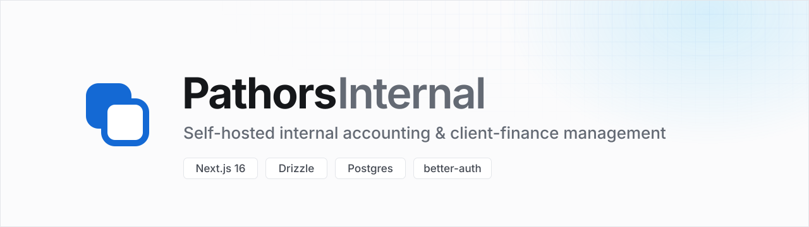
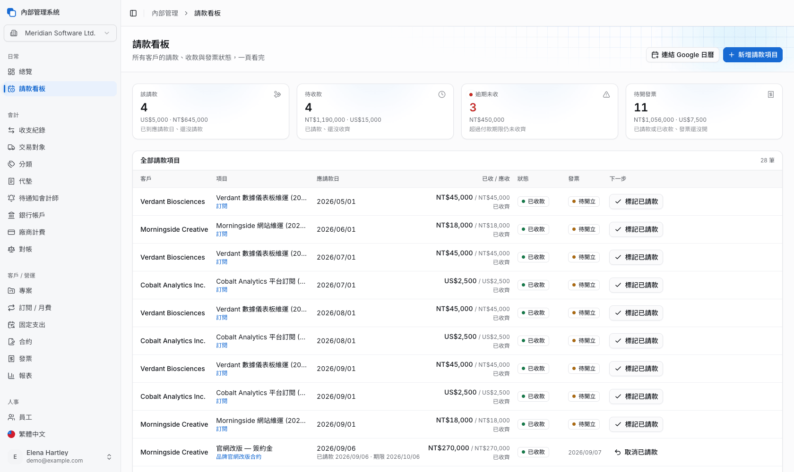
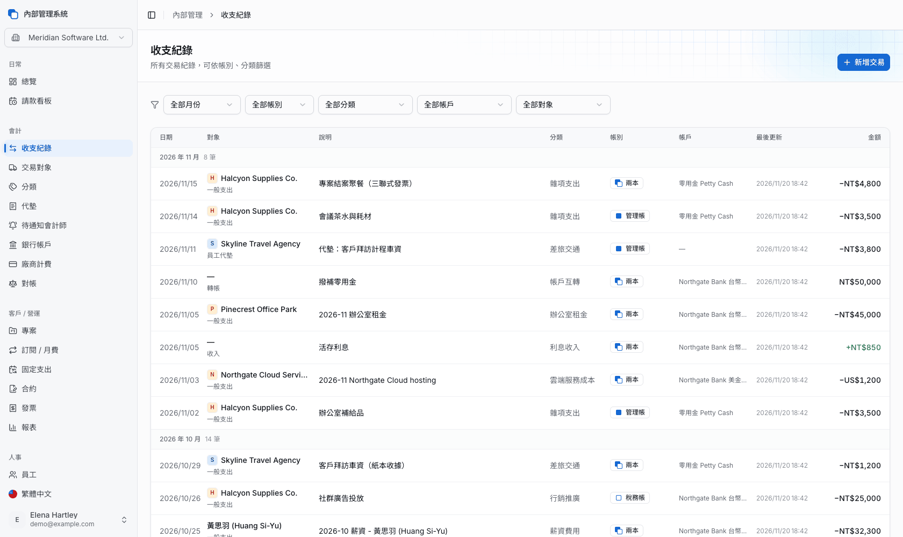
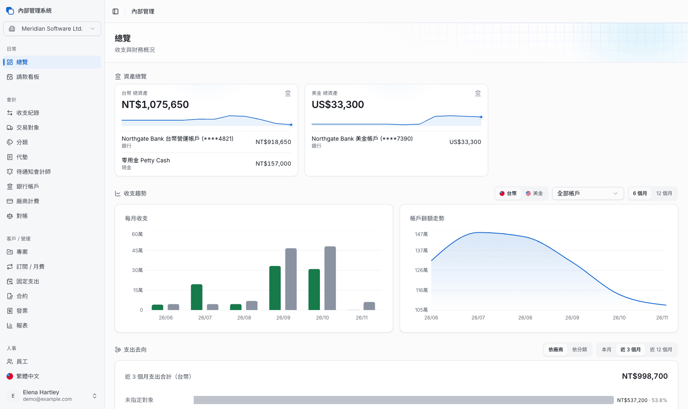
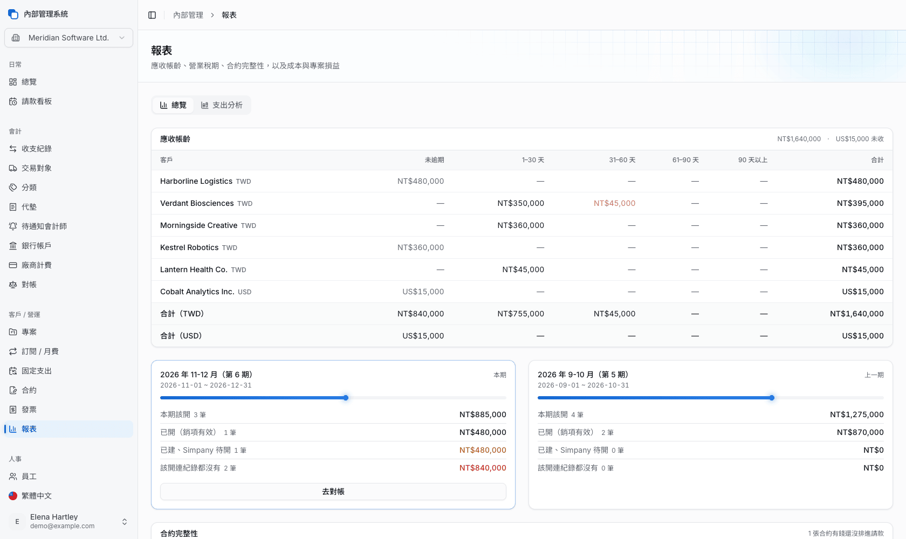

<p align="center">
  
</p>

<p align="center">
  <a href="./LICENSE"></a>
  
</p>

<p align="center">
  <a href="README.md">English</a> · <b>繁體中文</b>
</p>

<h1 align="center">Internal</h1>

<p align="center">
  <b>給小公司自己架的帳務與客戶收款管理系統。</b><br/>
  一套部署服務多個組織，每一筆資料都以 <code>organization_id</code> 隔開。
</p>

<!-- intro-video -->

---

一本帳、兩種檢視：**管理帳**與**稅務帳**。另一邊追蹤別人欠你的錢：專案、合約、訂閱、發票，以及誰還沒付款。這是我們自己每天在用的內部工具，不是通用型 ERP。

### 管理帳與稅務帳

這是一般公司都有的**管理會計**與**稅務會計**之分，不是兩套互相矛盾的數字。**管理帳**是公司為了自己做決策要追蹤的一切：專案損益、專案之間的成本分攤、確實是成本但不能報稅的支出、放在外幣錢包裡的餘額、錢已經進來但還沒開發票的收入。**稅務帳**是會計師拿來申報的那一部分，也就是有合格發票與收據佐證的分錄。每一筆交易都有一個 `book` 標記（`both` 兩本都記、`internal` 只進管理帳、`external` 只進稅務帳），兩種檢視讀的是同一批資料，隨時可以互相對帳。

這是一個記帳工具。它本身不會向稅務機關申報（選用的 Simpany 整合只是把文件交給你的會計師），也不是設計來、更不打算幫任何人短報收入或虛報支出。每一筆分錄在稅務上怎麼處理，仍然是公司與會計師的責任。

介面有英文與繁體中文，每個使用者可以在側欄自己切換。程式碼、文件與設定檔是英文。

---

## 長什麼樣子

> 截圖來自示範組織（`scripts/seed-demo-org.ts`），公司、客戶與數字都是虛構的。畫面是繁體中文介面，可以從側欄切成英文。

另外有一個 [landing page](https://pathorsai.github.io/internal/) 用同樣的脈絡介紹它，原始檔是 [`docs/index.html`](docs/index.html)，透過 GitHub Pages 發佈。

<table>
  <tr>
    <td width="50%" valign="top">
      
      <p><b>請款看板</b>：整個請款流程在同一頁。<br/>
      <sub>誰該請款、誰已經請款、誰還欠你錢。合約的一次性分期款和訂閱的每期費用合併成一張清單，每一列都寫好下一步。</sub></p>
    </td>
    <td width="50%" valign="top">
      
      <p><b>收支紀錄</b>：管理帳和稅務帳在同一個地方。<br/>
      <sub>每一筆交易都帶 <code>book</code> 標記，兩種檢視來自同一批紀錄，而不是兩份會越差越遠的試算表。可以依月份、帳別、分類或帳戶篩選。</sub></p>
    </td>
  </tr>
  <tr>
    <td width="50%" valign="top">
      
      <p><b>總覽</b>：錢實際上在哪裡。<br/>
      <sub>每個帳戶、每種幣別各自的餘額，不偷偷換匯；每月收支對照，以及餘額走勢。</sub></p>
    </td>
    <td width="50%" valign="top">
      
      <p><b>報表</b>：應收帳齡、營業稅期、合約完整性。<br/>
      <sub>每個客戶的帳齡分段、每一期營業稅還有哪些該開的發票，以及檢查每份合約的金額是否都已排進請款項目。</sub></p>
    </td>
  </tr>
</table>

## 功能

- **多組織**：一套部署、多個組織，使用 [better-auth](https://better-auth.com) 的 organization 外掛。每一筆資料都以 `organization_id` 隔開，有組織切換器與 owner／admin 角色。
- **管理帳與稅務帳的帳本**：每筆交易的 `book` 欄位說明它屬於管理帳、稅務帳，還是兩本都記。請見[管理帳與稅務帳](#管理帳與稅務帳)。
- **會計核心**：交易、分類、銀行帳戶、交易對象、對帳、代墊與報銷。
- **客戶收款**：專案、合約（含分期付款排程）、訂閱與應收帳款。
- **請款看板**：合約分期款與訂閱各期合併成一張可以直接處理的清單。
- **Google 日曆**：請款、收款與開發票的日期會推到一個專用的提醒日曆，催款提醒交給 Google 發，不需要排程工作。
- **薪資**：員工、薪資項目類型與發薪批次。
- **報表**：應收帳齡、營業稅期、合約完整性、成本與專案損益。
- **文件**：上傳檔案到物件儲存（例如附在交易上的收據）。
- **MCP**：帳本也以 MCP server 開放，AI agent 可以查詢與記帳。請見 [`docs/mcp.md`](docs/mcp.md)。
- **雙語介面**：英文與繁體中文，每個使用者各自切換，不用重新載入、網址也不變。請見[多語系](#多語系)。
- **登入**：Google OAuth、企業 SSO（任何 OIDC 供應商，依 email 網域導向）與 email＋密碼，全部透過 better-auth；以邀請管理成員，以及組織設定。請見 [`docs/sso.md`](docs/sso.md)。

## 技術組成

| 層 | 選擇 |
| --- | --- |
| 前端 | Next.js 16（App Router）、React 19、Tailwind CSS v4、shadcn/ui + Base UI |
| 多語系 | next-intl（以 cookie 記語系，網址不帶語系） |
| 後端 | Next.js Route Handlers／Server Actions、better-auth |
| 資料庫 | Postgres + Drizzle ORM（schema 只由資料庫反推，migration 是純 SQL） |
| 工具 | Bun |

它沒有綁定任何主機，就是一個標準的 Next.js + Postgres 應用程式。**我們**剛好跑在哪裡只是其中一種選擇，請見[部署](#部署)。

---

## 快速開始

**需要：** [Bun](https://bun.sh)、一個 Postgres 資料庫，以及 Google OAuth 憑證。

```bash
bun install
```

```bash
cp .env.example .env.local      # DATABASE_URL, BETTER_AUTH_SECRET, Google OAuth…
```

```bash
bun dev                          # http://localhost:3000
```

`BETTER_AUTH_SECRET` 用 `openssl rand -base64 32` 產生。Google OAuth 請建立一個「網頁應用程式」類型的 OAuth client，並把 `http://localhost:3000/api/auth/callback/google` 加進授權的重新導向 URI（部署前記得加上正式網址）。

第一個登入的使用者會進到 `/onboarding`。要讓某人成為既有組織的 owner，修改 [`scripts/bootstrap-owner.sql`](scripts/bootstrap-owner.sql) 裡的 `v_email` 後對資料庫執行。

### 不用 Google 登入

Google 是主要的登入方式，但不是唯一的方式。

**Email＋密碼。** 自己架、又完全不想接 Google 時很方便。任何人都可以在 `/signup` 建立帳號，但 email 會在**設定密碼之前**先驗證：表單會寄出一封確認信（透過 Resend，要設定 `RESEND_API_KEY`），點了連結才建立帳號，之後使用者才設定密碼。刻意不讓人先設密碼再註冊：better-auth 是用 email 地址連結帳號的，如果有人能拿別人的 email 自行註冊一個未驗證的密碼帳號，攻擊者就能先佔位，等真正的主人用 Google 登入（或者在 better-auth 預設的 `requireLocalEmailVerified` 之下，讓真正的主人反而無法用 Google 登入）。忘記密碼可以在 `/forgot-password` 重設。已經註冊 SSO 供應商的 email 網域不能自行註冊，請見 [`docs/sso.md`](docs/sso.md)。

也可以在伺服器端直接建立帳號，例如給審核員用，或直接加進某個組織：

```bash
bun scripts/create-user.ts --email you@example.com \
  --password 'a-long-passphrase' --name 'Your Name' --org your-org-slug
```

密碼至少 12 個字元。改用 `CREATE_USER_PASSWORD` 環境變數傳密碼、不用 `--password`，密碼就不會留在 shell 歷史裡。

**企業 SSO。** 任何 OIDC 供應商，依 email 網域導向：使用者輸入 email 後就被交給對應的 IdP。註冊同樣只能在伺服器端進行。請見 [`docs/sso.md`](docs/sso.md)。

## 設定

| 變數 | 用途 |
| --- | --- |
| `DATABASE_URL` | Postgres 連線字串（連線池） |
| `DATABASE_DRIVER` | 選填：`neon-http` 或 `pg`。預設 `*.neon.tech` 用 `neon-http`，其他用 `pg` |
| `DATABASE_POOL_MAX` | 選填：每個行程的 node-postgres 連線池大小（預設 10） |
| `BETTER_AUTH_SECRET` | Session 簽章密鑰（`openssl rand -base64 32`） |
| `BETTER_AUTH_URL` | 應用程式網址，結尾不加斜線 |
| `GOOGLE_CLIENT_ID` / `GOOGLE_CLIENT_SECRET` | Google OAuth 憑證（登入**以及**選用的 Google 日曆整合） |
| `RESEND_API_KEY` | 寄註冊確認信與密碼重設信用的 Resend API key。正式環境必填；開發時沒設定會把信件內容印在 console |
| `RESEND_FROM` | 選填：寄件人，預設 `Pathors Internal <noreply@pathors.com>` |
| `USAGE_TRACKING` | 選填：設 `off` 就不記功能使用紀錄（見下方）。預設開啟 |

完整範本請見 [`.env.example`](.env.example)。

### 功能使用紀錄

Internal 會記哪些功能有人在用，讓擁有者與管理員找出沒人需要的頁面和工具（設定 › 功能使用狀況）。
資料只存在**你自己的資料庫**（`usage_events` 表），不送去任何第三方 analytics，也不在瀏覽器裡跑。

- **記什麼：** dashboard 每次載入頁面時，記組織、使用者、路由 *pattern*（`/dashboard/ai/[id]`，不記實際的 id）與時間。
  MCP、REST API、站內 AI、聊天 bot 每次呼叫工具時（讀取也算），記組織、使用者、管道、工具名稱、成功或失敗、耗時。
- **不記什麼：** query string、頁面內容、工具參數、工具回傳值、IP、user agent。
- 同一個人 30 秒內重複載入同一頁只算一次。超過 180 天的資料由每日 cron 刪掉。
- 設 `USAGE_TRACKING=off` 就停止記錄。細節見 [`docs/usage-tracking.md`](docs/usage-tracking.md)。

---

## 多語系

介面提供**英文**與**繁體中文（zh-TW）**。使用者從側欄切換語系，選擇存在 `locale` cookie。

網址刻意**不帶語系**：`/billing` 在每種語言都是 `/billing`。這樣登入的 callback、MCP endpoint 和所有書籤都不會因語系而變。

```
src/i18n/
  config.ts            # locale list, default, cookie name
  request.ts           # next-intl request config
  messages/
    dictionary.ts      # Leaf / Dictionary types + locale projection
    <area>.ts          # one file per area, all locales side by side
```

每個字串的各語言翻譯放在一起，而不是分成兩棵平行的檔案樹：

```ts
const dashboard = {
  title: { "zh-TW": "總覽", en: "Overview" },
} satisfies Dictionary;
```

某個 key 缺了一種語言，或語言名稱打錯，會是 **build error**，而不是悄悄退回預設字串。兩種語言放在同一個 key 上，缺漏就出現在你正在讀的地方；新增語言也變成照編譯器提示一個個補，而不是比對兩個檔案。翻譯用 [next-intl](https://next-intl.dev) 讀取：Client Component 用 `useTranslations()`，Server Component 與 Server Action 用 `await getTranslations()`。Server Action 會自己翻譯驗證錯誤，所以跳出來的 toast 訊息和觸發它的頁面是同一種語言。

新增語系：把它加進 `src/i18n/config.ts` 的 `locales`，TypeScript 會帶你走過每一個需要補翻譯的 key。

---

## 資料庫

透過 **Drizzle ORM** 使用 Postgres。`src/db/schema.ts` 是從資料庫反推出來的（`bun run db:pull`），應用程式從不主動推 schema；[`migrations/`](migrations) 底下全是只往前的純 SQL。沒有任何特定供應商的 SQL，所以**任何 Postgres 都能用**。

Drizzle client 在 [`src/db/index.ts`](src/db/index.ts)，把 `DATABASE_URL` 指向你的資料庫就好。驅動程式在執行時決定：Neon 主機用 Neon 的 HTTP 驅動，其他 Postgres 用 `node-postgres`，Cloudflare Workers 則可以透過 Hyperdrive binding 連到任何 Postgres。要指定就設 `DATABASE_DRIVER`，細節請見[部署指南](docs/deployment.md#database-driver)。

`bun run db:apply` 會依序套用 `migrations/`（空資料庫從 `0000_baseline.sql` 開始），並記錄套用過哪些，所以重複執行只會套用新的檔案，請見 [Migrations](docs/deployment.md#migrations)。

## 部署

建置（`bun run build`）後，跟其他 Next.js 應用程式一樣執行，任何能跑 Next.js 並連到 Postgres 的地方都可以。這個 repo 不指定主機。

**[部署指南](docs/deployment.md)**舉了兩個具體的例子：**Docker 自架**（不綁供應商的 Node + Postgres，附 [`Dockerfile`](Dockerfile) 與 [`docker-compose.yml`](docker-compose.yml)），以及**我們**剛好在用的 serverless 架構。兩者都不是必要條件。

---

## 專案結構

```
src/
  app/            # Next.js App Router (dashboard pages, auth routes, onboarding)
  components/     # UI components (shadcn/ui + Base UI) and shared widgets
  db/             # Drizzle client, introspected schema, queries & mutations
  i18n/           # locale config and bilingual message catalogue
  lib/            # auth (better-auth), session helpers, object storage, utils
migrations/       # plain forward-only SQL migrations
scripts/          # one-off operational scripts (bootstrap-owner, create-user, register-sso-provider)
docs/             # landing page (GitHub Pages root), deployment guide, MCP + SSO docs, assets
Dockerfile        # vendor-neutral self-host image
docker-compose.yml
```

## 參與貢獻

歡迎開 issue 和 pull request。bug 與功能建議請用 [GitHub Issues](../../issues)，開 PR 前請先讀 [`CONTRIBUTING.md`](CONTRIBUTING.md)。回報安全漏洞請照 [`SECURITY.md`](SECURITY.md) 的方式，不要開公開的 issue；自己架設的人也請讀[安全性說明](docs/security.md)。使用者看得到的字串一律要走 i18n，不能寫死在程式裡，訊息檔的位置請見[多語系](#多語系)。

## 授權

以 [Apache License 2.0](./LICENSE) 授權。你可以自由使用、修改與再散佈，包括商業用途，只要保留授權與著作權聲明。
